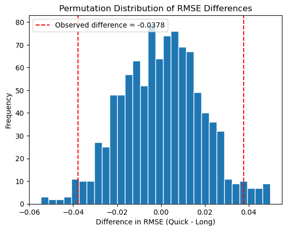

**DSC 80 Project 4 — UC San Diego**

**Author: Alyssa Gong**

## Introduction

**Research question:** What characteristics of a recipe are associated with higher average user ratings?

Online recipe platforms contain thousands of recipes, but it is not always clear what characteristics are associated with higher user ratings. Understanding these relationships can help readers make more informed choices when selecting recipes and provide insight into what makes a recipe appealing to users.

This project investigates whether preparation time, ingredient count, and recipe complexity are associated with higher average ratings. I use exploratory data analysis, permutation tests, and predictive modeling on Food.com recipe and interaction data.

The dataset contains **83,782 recipes** and **731,927 user interactions**. The relevant columns include:
- `minutes`: the time required to prepare a recipe.
- `n_ingredients`: the number of ingredients used in a recipe.
- `n_steps`: the number of preparation steps.
- `rating`: the average user rating for each recipe, calculated from recorded interactions.

## Data Cleaning and Exploratory Data Analysis

### Dataset and cleaning

The recipes dataset contains **83,782 recipes** and the interactions dataset contains **731,927 user interactions**. I replaced interaction ratings of zero with missing values because they do not represent valid numerical ratings, then computed the mean nonmissing rating for each recipe. A left merge on recipe ID retained all 83,782 recipes. Of these, **81,173 have a recorded average rating** and **2,609 (3.11%) do not**.

The analysis focuses on preparation time (`minutes`), ingredient count (`n_ingredients`), number of steps (`n_steps`), and average recipe rating (`rating`).

### Preview of the Cleaned Dataset

After replacing zero ratings with missing values and merging the average ratings with the recipe information, the resulting dataset contains 83,782 recipes. The table below displays the first five rows, with selected columns for readability.

| Recipe Name | Recipe ID | Minutes | Steps | Ingredients | Average Rating |
|:---|---:|---:|---:|---:|---:|
| 1 brownies in the world best ever | 333281 | 40 | 10 | 9 | 4 |
| 1 in canada chocolate chip cookies | 453467 | 45 | 12 | 11 | 5 |
| 412 broccoli casserole | 306168 | 40 | 6 | 9 | 5 |
| millionaire pound cake | 286009 | 120 | 7 | 7 | 5 |
| 2000 meatloaf | 475785 | 90 | 17 | 13 | 5 |

*Only six of the dataset's columns are shown to keep the preview readable.*

### Distribution of Average Recipe Ratings

<iframe src="rating_distribution.html" width="100%" height="500" style="border:none;"></iframe>

**Interpretation:** Ratings are strongly concentrated near five stars, with relatively few recipes averaging below four stars. This concentration makes meaningful differences between recipes harder to predict.

### Distribution of Recipe Preparation Times

<iframe src="preparation_time_distribution.html" width="100%" height="500" style="border:none;"></iframe>

**Interpretation:** Preparation times are right-skewed. Most recipes take approximately 10–60 minutes, with a concentration around 20–40 minutes. The graph shows only times from 1 to 180 minutes for readability; this restriction does not change the underlying merged dataset.

### Preparation Time vs. Average Rating

<iframe src="rating_by_preparation_time.html" width="100%" height="500" style="border:none;"></iframe>

**Interpretation:** Recipes taking 1–180 minutes are grouped into 15-minute intervals. Average ratings remain fairly steady, around 4.60–4.68 stars, without a clear upward or downward trend. The x-axis marks the start of each interval.

### Ingredient Count vs. Average Rating

<iframe src="rating_by_ingredient_count.html" width="100%" height="500" style="border:none;"></iframe>

**Interpretation:** Among recipes with 1–30 ingredients, there is no consistent relationship between ingredient count and average rating. Ratings fluctuate more at high ingredient counts, where fewer recipes are available—for example, 8,657 recipes have eight ingredients, but only 11 have 30.

### Quick vs. Long Recipes

| Preparation time | Number of rated recipes | Mean rating |
|---|---:|---:|
| Quick (≤60 minutes) | 60,988 | 4.6293 |
| Long (>60 minutes) | 20,184 | 4.6135 |

Quick recipes are more common and have slightly higher average ratings, but the difference is only about **0.016 stars**.

## Assessment of Missingness

Missing values occur in `name` (1 recipe), `description` (70 recipes), and `rating` (2,609 recipes). Because rating is the prediction target, I examined whether its missingness is associated with observable recipe characteristics.

### Missing Ratings and Preparation Time

<iframe
  src="missingness_preparation_time.html"
  width="100%"
  height="500"
  style="border:none;"
  title="Recipe Preparation Time by Rating Missingness">
</iframe>

I compared the mean preparation times of recipes with and without recorded ratings, restricting this analysis to 1–180 minutes. Under the null hypothesis, the preparation-time distributions are the same in the two groups. I used the absolute difference in means as the test statistic and ran 1,000 permutations.

| Group | Mean preparation time |
|---|---:|
| Recorded rating | 41.56 minutes |
| Missing rating | 48.93 minutes |

The observed difference was **7.37 minutes**, with a permutation **p-value ≈ 0.001**. At the 5% significance level, this is evidence against missing completely at random (MCAR). The association with an observed variable is consistent with possible MAR, but does not establish MAR rather than MNAR.

### Missing Ratings and Breakfast Tag

I also compared the proportions of missing ratings for breakfast-tagged and other recipes. The missing-rating rates were **3.08%** and **3.12%**, respectively. The absolute difference was approximately **0.00040**, with permutation **p = 0.8811**.

This test does not find evidence of an association with the breakfast tag, though it does not prove independence. Because this comparison was selected after exploring multiple recipe characteristics, it should be treated as exploratory.

### NMAR Analysis

One column that could potentially be **Not Missing At Random (NMAR)** is `rating`. Recipes without recorded ratings may be missing them because users are less motivated to rate recipes they did not enjoy, or because certain recipes receive less engagement overall. If the probability of a rating being missing depends on the unobserved rating itself, this would constitute NMAR missingness.

However, we cannot determine whether ratings are NMAR from the observed data alone. Additional information, such as recipe views, cooking attempts, user engagement, and whether users chose not to leave ratings, could help explain why ratings are missing. If these observed variables accounted for the missingness, the mechanism might instead be considered Missing At Random (MAR).

## Hypothesis Testing

I performed two two-sided permutation tests with 1,000 permutations each, using the absolute difference in mean ratings as the statistic and a 0.05 significance level.

For each test, I randomly shuffled the group labels while preserving the original group sizes, simulating the null hypothesis that the two groups have the same rating distribution. For each permutation, I recalculated the absolute difference in group means. The p-value is the proportion of simulated differences that were at least as large as the observed difference.

### Preparation Time and Ratings

**Null hypothesis:** Quick recipes (≤60 minutes) and long recipes (>60 minutes) have equal mean ratings.

**Alternative hypothesis (H₁):** Recipes taking 60 minutes or less and recipes taking more than 60 minutes have different population mean ratings.

The average ratings were **4.6293** for quick recipes and **4.6135** for long recipes, an absolute difference of **0.01585**. The permutation **p-value was 0.003**. This is statistically significant, but the difference is too small to suggest a substantial practical advantage for quick recipes.

### Ingredient Count and Ratings

**Null hypothesis:** Recipes with ≤10 ingredients and recipes with >10 ingredients have equal mean ratings.

**Alternative hypothesis (H₁):** Recipes with 10 or fewer ingredients and recipes with more than 10 ingredients have different population mean ratings.

The average ratings were **4.6247** and **4.6268**, respectively, an absolute difference of **0.00209**. The permutation **p-value was 0.655**. There is insufficient evidence of a difference between these groups.

Overall, neither preparation time nor ingredient count appears to have a strong standalone relationship with ratings.

## Framing a Prediction Problem

I aim to predict a recipe's **average user rating** from features known when the recipe is submitted, before user ratings are available. Because the target is continuous, this is a **regression** problem. I used an 80% training / 20% held-out test split (`random_state=42`) and evaluated performance with **root mean squared error (RMSE)** and **R²**. Lower RMSE indicates better predictions. I chose RMSE because it measures prediction error in the original rating scale and penalizes larger prediction errors more heavily, making it useful for evaluating this regression task.

## Baseline Model

The baseline model was a linear regression model implemented in a scikit-learn Pipeline. It used three quantitative features: preparation time, ingredient count, and number of steps. I split the data into 80% training data and 20% testing data, using `random_state=42`.

- **Test RMSE:** 0.6360
- **Test R²:** −0.00042

The slightly negative R² indicates that these features in a linear model explain essentially none of the variation in average recipe ratings. This provides a baseline against which to evaluate more complex models.

The model uses **3 quantitative features, 0 ordinal features, and 0 nominal features**. Since all predictors are numerical, no categorical encoding is necessary.

## Final Model

I developed a **Random Forest Regressor** to capture potentially nonlinear relationships between recipe characteristics and ratings.

First, I engineered six numerical features: preparation time, ingredient count, step count, log-transformed preparation time, description length, and tag count. I then added **11 binary recipe-category indicators** (including breakfast, desserts, vegetarian, and easy), resulting in 17 features total.

These features were selected to capture different aspects of a recipe. Log-transformed preparation time helps represent potentially nonlinear relationships between cooking time and ratings. Description length and tag count provide additional measures of recipe detail, while binary category indicators capture differences between recipe types that may not be reflected by numerical features alone.

I compared the six-feature and 17-feature models using three-fold cross-validation, then tuned the expanded model with `RandomizedSearchCV` over the number of trees, maximum depth, minimum leaf size, and feature sampling. All model selection and hyperparameter tuning used training data only.

The best hyperparameters selected by `RandomizedSearchCV` were:
- **Number of trees (`n_estimators`):** 150
- **Maximum depth (`max_depth`):** 5
- **Minimum samples per leaf (`min_samples_leaf`):** 5
- **Maximum feature fraction (`max_features`):** 0.75

The best cross-validation RMSE was approximately **0.6400**.

I evaluated the final models on the held-out test set:

| Model | Test RMSE | Test R² |
|---|---:|---:|
| Baseline linear regression | 0.6360 | −0.00042 |
| Initial six-feature random forest | 0.6355 | — |
| Tuned 17-feature random forest | **0.6340** | **0.00585** |

The final model improved RMSE by approximately **0.314%** relative to the baseline. Although the tuned Random Forest performed slightly better, its R² indicates that it explained only about **0.59%** of the variation in ratings. This suggests that recipe metadata alone is not a strong predictor of user ratings, and that other factors, such as individual preferences and reviewer behavior, may play a larger role.

## Fairness Analysis

I compared the final model's prediction errors for **quick recipes (≤60 minutes)** and **long recipes (>60 minutes)** on the held-out test set. I used the difference in group RMSE (quick minus long) and a two-sided permutation test with 1,000 permutations.

**Null hypothesis (H₀):** The distribution of squared prediction errors is the same for quick and long recipes.

**Alternative hypothesis (H₁):** The distributions of squared prediction errors differ between the two groups.

**Test statistic:** Difference in RMSE (quick recipes minus long recipes).

**Significance level:** 0.05.

| Group | Test recipes | RMSE |
|---|---:|---:|
| Quick | 12,171 | 0.6243 |
| Long | 4,064 | 0.6621 |

The observed RMSE difference was **−0.0378**, indicating lower prediction error for quick recipes. The permutation **p-value was approximately 0.0480**. Since this is below the 0.05 significance level, I reject the null hypothesis. There is marginal statistical evidence that the model's prediction errors differ between quick and long recipes, with better observed predictive performance for quick recipes. However, this statistical difference does not by itself establish broader ethical unfairness.

## Conclusion

Recipe ratings are concentrated near the high end of the scale. Shorter recipes have a statistically detectable but very small advantage in mean rating, while ingredient count shows no significant difference in the tested groups. Rating missingness is associated with preparation time, so missingness should not automatically be treated as completely random.

Predictive modeling reinforces the main finding: **preparation time, ingredients, steps, and category tags alone offer very limited ability to predict average ratings**. Individual preferences, review behavior, and other unmeasured factors likely play an important role.

The fairness analysis also found marginal statistical evidence of different prediction errors between quick and long recipes, with the model performing slightly better on quick recipes. This highlights a limitation of the model and the importance of considering performance across different recipe groups.
